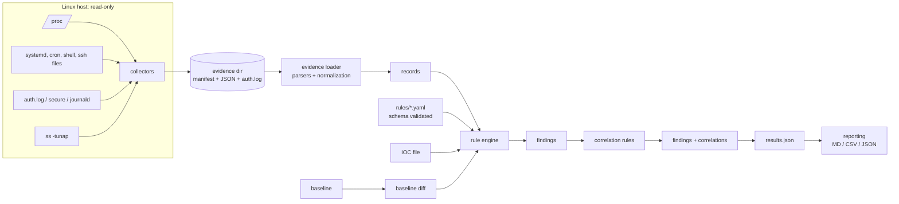

# Architecture

## Modules (`src/linux_threat_hunter/`)

| Module | Responsibility |
|---|---|
| `cli.py` | argument parsing, exit codes, user-facing errors |
| `config.py` | defaults, YAML overrides, validation (limits, redaction, variables, overrides, allowlists) |
| `models.py` | `Record`, `Finding`, `RuleStatus`, severity/confidence vocabularies |
| `platform_info.py` | distribution (`os-release`), init system, architecture |
| `collectors/` | one module per telemetry source (`host`, `process`, `network`, `persistence`, `auth`, `files`); `base.py` has the context (injectable `fs_root`, `proc_root`, runner) and result types; `__init__.py` orchestrates and isolates failures |
| `parsers/` | `auth` (sshd/sudo lines), `network` (`ss`), `persistence` (systemd units, cron) |
| `evidence/` | evidence directory format, safe loading, enrichment (parent process, socket owner), hashes, writing |
| `rules_engine/` | `schema.py` (rule validation), `conditions.py` (the condition language), `loader.py`, `engine.py` (rule types and correlation) |
| `detections/` | locates the rule catalog (`rules/` in a checkout, `_rules` in a wheel, or `$LTH_RULES_DIR`) |
| `ioc/` | IOC validation, normalization, per-source matching |
| `baseline/` | baseline creation, integrity validation, comparison, explicit update |
| `correlation/` | documentation of the correlation model (implemented as rules in the engine) |
| `attack/` | technique registry (IDs, official titles, tactics, URLs) and mapping validation |
| `reporting/` | results builder and writers (JSON, CSV, Markdown) with redaction |
| `utils/` | safe subprocess/file helpers, redaction, time parsing |

## Data flow

1. **Collect** (`collect`): each collector returns data plus status (`ok`, `partial`, `failed`) and notes. Output is written atomically with a manifest containing collection time, timezone and SHA-256 of each file.
2. **Load**: the loader reads only known filenames, refuses symlinks and oversize files, tolerates malformed input (warnings), parses `auth.log` into events with UTC timestamps (original timestamp and zone context preserved), normalizes persistence artifacts (unit `Exec*` commands, cron jobs, referenced-path existence) and enriches processes/sockets.
3. **Evaluate** (`hunt`): rules of each type run against records; baseline and IOC rules use the diff and IOC set when supplied; allowlists suppress records (counted). Correlation rules run last over the findings. Each rule gets a status (`executed`/`skipped` with reason).
4. **Report**: `results.json` is the single source; `report` renders the Markdown, CSV and ATT&CK summaries from it, applying redaction.

## Identifiers

- Finding IDs are stable: `LTH-F-` + first 12 hex of SHA-256(`rule_id` + a key derived from the evidence record or group).
- Evidence references are `<file>#<index>` (position in the JSON list, or line number for `auth.log`) and resolve with `trace`.

## Extension points

- **New rule**: add YAML under `rules/<area>/` (see [rule-authoring](rule-authoring.md)). No code needed for most rules.
- **New configuration variable**: add it under `variables` in `config.py` and `configs/default.yaml`, then reference `$name`.
- **New collector**: add a module returning `CollectorResult`, register a `CollectorSpec` in `collectors/__init__.py`, and add its output file to `evidence/store.py` (`JSON_SOURCES`) plus a data-source name to `models.DATA_SOURCES`.
- **New IOC mapping**: extend `IocSet.match_record` for the data source.
- **New ATT&CK technique**: add to `attack/techniques.py` with its official title, tactics and URL, then use it in a rule (the schema validates tactic membership).
- **Imported events**: place command events in `events.json` (see [examples](examples.md)).

## Design decisions

- Rules are data, not code: easier to review, safe to share, and bounded in cost.
- Collection and analysis are separate: evidence can be analyzed on another machine, any OS, without privileges.
- Unknown is not false: missing fields never match conditions, missing sources skip rules visibly.
- Writes never replace previous artifacts silently (evidence, baselines).
