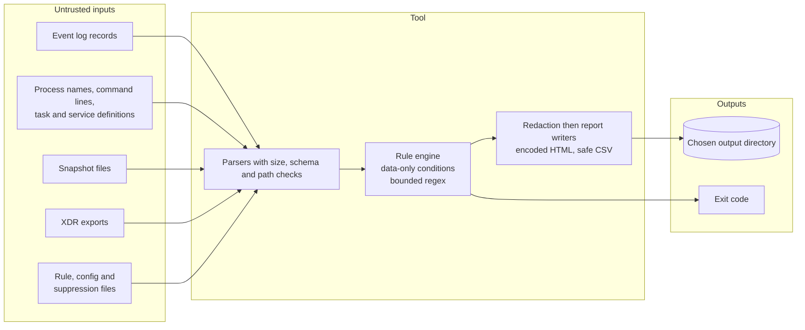

# Threat model

This document describes what the toolkit protects, who might attack it or abuse it, and what it does about that. It covers the tool itself, not the endpoints it inspects.

## What the tool is

A read-only triage utility run by an authorized analyst or administrator on a Windows host, or on any machine against a saved snapshot. It reads system state, matches it against local rules, and writes reports to a directory the user chooses.

## Assets

| Asset | Why it matters |
|---|---|
| The inspected system's state | The tool must not change it |
| Snapshots and reports | They contain host names, account names, command lines and paths, and possibly secrets typed on command lines |
| The analyst's workstation | It opens reports and parses untrusted files |
| Detection integrity | A silently broken rule or missing data would give false assurance |

## Trust boundaries

Everything on the left may be attacker-influenced (for example, an attacker names a process or task with markup or a formula, or plants a huge or malformed event). Nothing on the right is sent anywhere.

## Abuse cases and mitigations

| Threat | Mitigation | Verified by |
|---|---|---|
| Tool changes the inspected system | No state-changing cmdlets in the source; collectors call small read-only wrapper functions | Source scan test |
| Tool executes a discovered item | Items are parsed as text only; no process start, no evaluation of strings | Source scan test |
| Data exfiltration | No network cmdlets; no telemetry; no auto-update | Source scan test |
| Malicious rule or config file runs code | Rules and config are data; unknown keys rejected; conditions are a closed operator set | Rule and config validation tests |
| Regular-expression denial of service | Pattern length limit, nested-quantifier screen, per-match timeout, input truncation | Regex tests |
| XML external entity or entity expansion in an event record | DTDs prohibited, no resolver, document size cap | Event tests with a hostile fixture |
| Oversized or malformed input | Maximum file sizes, schema checks, per-source item caps; bad rows skipped and reported | Snapshot, XDR and event tests |
| Path abuse (traversal, UNC, URL, wildcard, alternate data streams, symbolic-link output) | Central path validation; protected system directories refused | Path tests |
| Overwriting existing files | Refused unless `-Force` | Report and snapshot tests |
| HTML injection or script in a report | All values encoded; no script; restrictive CSP meta tag | Report escaping tests |
| CSV formula injection | Leading `=`, `+`, `-`, `@` neutralised | Report escaping tests |
| Secrets and user names in reports | Secret-pattern redaction and account tagging by default | Redaction tests |
| Missing data read as "clean" | Coverage statuses, skipped-rule list and exit code 3 | Hunt and exit-code tests |
| Silent loss of detections from a broken rule | Any invalid rule stops the hunt (exit 2) | Hunt test with an invalid rule |
| Supply chain (CI) | Pinned actions by commit SHA, least-privilege `contents: read` token, pinned tool versions, dependency review and secret scanning, no `pull_request_target` | Workflow checks in the docs tests |

## Residual risks

- A privileged attacker can hide from, or falsify what Windows reports to, a user-mode tool.
- Redaction is heuristic. Reports should still be stored and shared as sensitive.
- Heuristic rules can be evaded by deliberate obfuscation and will produce false positives.
- An analyst can still make a mistake in a suppression; suppressions stay visible in reports for that reason.
- The ATT&CK catalog is maintained by hand and should be re-verified against the official site each release.
