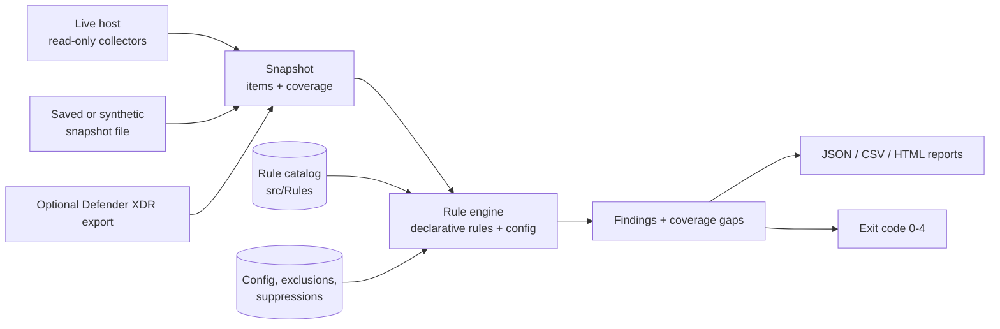
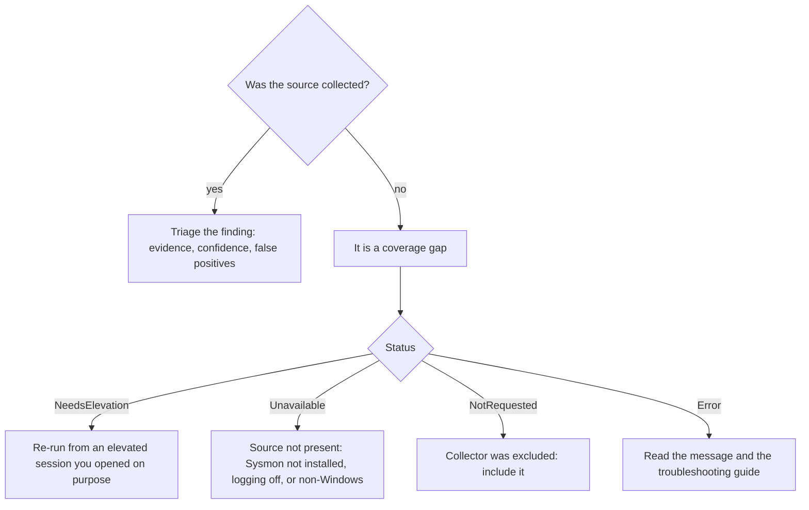
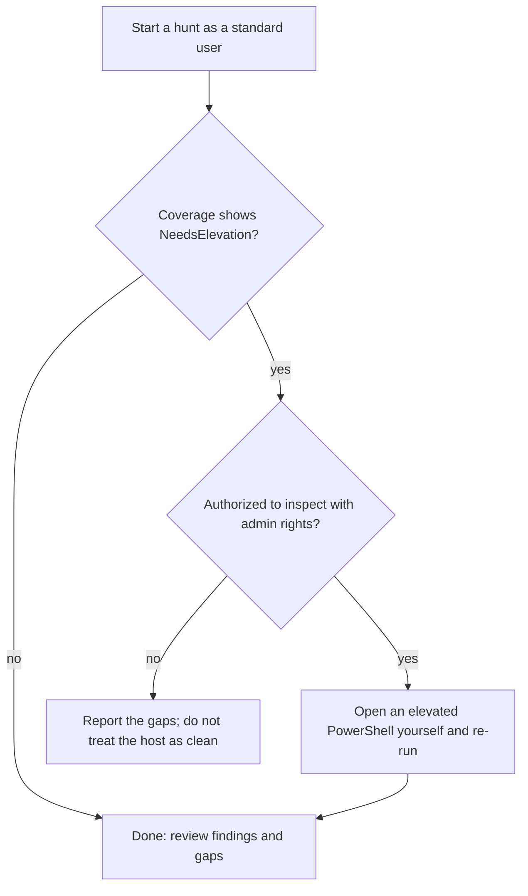

# Walkthrough

This walkthrough teaches the tool in three progressive exercises. **Every result shown here is simulated.** It was produced by running the commands against the synthetic snapshots in `sample-data/` with PowerShell 7.6.7 on Linux; no real endpoint was inspected. Host names, users and addresses (for example `WS-LAB-03`, `198.51.100.23`) are invented. Your own timestamps and report file names will differ.

You need only PowerShell and this repository. No Windows machine and no administrator rights are required for the exercises.

## How a hunt works



The engine only matches data against rules. It never runs anything it finds.

## Command reference

| Task | Command |
|---|---|
| Check config and rules | `./scripts/Invoke-WindowsThreatHunter.ps1 -ValidateOnly` |
| List rules | `./scripts/Invoke-WindowsThreatHunter.ps1 -ListRules` |
| Hunt a snapshot | `./scripts/Invoke-WindowsThreatHunter.ps1 -SnapshotPath <file>` |
| Hunt a live host (Windows) | `./scripts/Invoke-WindowsThreatHunter.ps1` |
| Limit collection (live) | `-Collector ScheduledTasks, Services, RegistryRun` |
| Save the raw snapshot (live) | `-ExportSnapshotPath <file> [-Force]` |
| Filter | `-RuleId WTH-TASK-*`, `-Category Persistence`, `-MinimumSeverity Medium` |
| Set the failing threshold | `-FailOnSeverity High` |
| Merge a Defender XDR export | `-DefenderXdrPath <file>` |
| Use configuration / suppressions | `-ConfigPath <file>`, `-SuppressionPath <file>` |
| Write reports | `-OutputDirectory <dir> [-Format Json,Csv,Html] [-Force]` |
| Run the demo | `./scripts/Invoke-Demo.ps1` |
| Run tests / lint | `./scripts/Invoke-Tests.ps1`, `./scripts/Invoke-Lint.ps1` |
| Module: collect | `Invoke-WthCollection`, `Export-WthSnapshot`, `Import-WthSnapshot` |
| Module: hunt and report | `Invoke-WthHunt`, `Export-WthReport`, `Get-WthExitCode` |
| Module: inspect | `Get-WthRule`, `Test-WthRule`, `Get-WthConfiguration`, `Test-WthConfiguration`, `Get-WthSuppression`, `Test-WthEnvironment`, `Import-WthDefenderXdrEvent` |

Exit codes: `0` clean and fully covered, `1` findings at or above `-FailOnSeverity`, `2` invalid input, `3` no findings but incomplete coverage, `4` unexpected error.

## Exercise 1: a clean-looking host, and why "clean" needs coverage

Goal: run a hunt, read the summary, and learn what exit code `0` means.

1. Validate the tool first:

```powershell
./scripts/Invoke-WindowsThreatHunter.ps1 -ValidateOnly
```

2. Hunt the benign synthetic workstation:

```powershell
./scripts/Invoke-WindowsThreatHunter.ps1 -SnapshotPath ./sample-data/snapshots/benign-workstation.json
```

Simulated output:

```text
*** SIMULATED DATA: synthetic snapshot, not a real endpoint ***
Host: WS-BENIGN-01   Collected: 2026-10-16T09:30:00.000Z   Origin: Synthetic
Rules executed: 38   skipped: 4   Items analyzed: 37
Active findings: 0   Suppressed: 0   (Critical 0, High 0, Medium 0, Low 0, Informational 0)
Exit code: 0
exit 0
```

What to notice:

- The banner states the data is simulated. Reports carry the same banner.
- `skipped: 4` rules are the optional Defender XDR rules (no export was supplied) or rules disabled by default. They are not treated as gaps, so the result is `0`.
- Exit code `0` means *this snapshot* had every source collected and no findings. It says nothing about a host that was only partly collected: on a live Windows host, collecting only one source with `-Collector` makes the exit code `3`.

## Exercise 2: persistence on a lab host

Goal: find persistence, read a finding, and suppress a reviewed false positive.

1. Hunt the persistence scenario, showing Medium and above:

```powershell
./scripts/Invoke-WindowsThreatHunter.ps1 -SnapshotPath ./sample-data/snapshots/lab-persistence.json -MinimumSeverity Medium
```

Simulated output (first lines):

```text
*** SIMULATED DATA: synthetic snapshot, not a real endpoint ***
Host: WS-LAB-02   Collected: 2026-10-16T09:30:00.000Z   Origin: Synthetic
Rules executed: 17   skipped: 18   Items analyzed: 26
Active findings: 16   Suppressed: 0   (Critical 0, High 5, Medium 11, Low 0, Informational 0)

Severity Confidence FindingType RuleId          Title
-------- ---------- ----------- ------          -----
High     Medium     Heuristic   WTH-EVT-003     Service WinUpdateHelper installed from a suspicious path or command
High     Medium     Heuristic   WTH-SVC-001     Service WinUpdateHelper runs from a user-writable path
High     Medium     Heuristic   WTH-SVC-003     Service RemoteHelper uses a shell, script host or download pattern
High     Medium     Heuristic   WTH-TASK-003    Privileged scheduled task \SysCache runs a program from a user-writable path
High     Medium     Heuristic   WTH-WMI-001     WMI CommandLineEventConsumer SysHealthConsumer is configured
Medium   Low        Heuristic   WTH-ACCT-001    WS-LAB-02\<user:9a02c3> is a member of Administrators but is not on the allowlist
Medium   High       Observation WTH-ACCT-002    The built-in Guest account is enabled
Medium   Low        Heuristic   WTH-EVT-004     Scheduled task \Microsoft\Windows\Maintenance\Sync created with a suspicious command
Medium   Medium     Observation WTH-EVT-005     Member added to Administrators at 2026-10-16T09:25:00.000Z
Medium   Low        Heuristic   WTH-REG-001     Run entry OneDrive starts a program from a user-writable path
Medium   Medium     Heuristic   WTH-REG-002     Run entry Updater uses a suspicious script or download pattern
Medium   Medium     Heuristic   WTH-STARTUP-001 Startup folder contains run-me.bat
Medium   Medium     Heuristic   WTH-STARTUP-002 Startup shortcut Helper.lnk has a suspicious target
Medium   Medium     Heuristic   WTH-TASK-001    Scheduled task \OneDrive Standalone Update Task-S-1-5-21-1111111111-2222222222-3333333333-1001 runs a program from a user-writable path
Medium   Medium     Heuristic   WTH-TASK-001    Scheduled task \SysCache runs a program from a user-writable path
```

2. Look at one finding in full:

```powershell
Import-Module ./src/Modules/WindowsThreatHunter/WindowsThreatHunter.psd1
$result = Invoke-WthHunt -SnapshotPath ./sample-data/snapshots/lab-persistence.json -RuleId WTH-TASK-001
$result.Findings[0] | Format-List Severity, Confidence, FindingType, Title, Explanation, FalsePositives, RecommendedNextStep
```

Every finding records the host, observation time, rule ID, evidence, severity, confidence, explanation and a next step. Severity and confidence are separate: a Medium severity finding with Low confidence is a lead to check, not a conclusion.

3. Understand the false positive. The `OneDrive Standalone Update Task` finding is the classic benign match: a per-user updater in AppData. The rule's false-positive guidance says so. Suppress it with a written reason:

```powershell
./scripts/Invoke-WindowsThreatHunter.ps1 -SnapshotPath ./sample-data/snapshots/lab-persistence.json -SuppressionPath ./config/suppressions.example.json
```

The active count drops by one and the summary shows `Suppressed: 1` (simulated run: 18 active, 1 suppressed, from 19). The suppressed finding still appears in the reports with its reason, so a reviewer can disagree.

## Exercise 3: an intrusion, coverage gaps, and reports

Goal: combine endpoint data with an imported Defender XDR export, read the coverage gaps, and produce reports.



1. Hunt the intrusion scenario, merge the (simulated) XDR export, and show High and above:

```powershell
./scripts/Invoke-WindowsThreatHunter.ps1 -SnapshotPath ./sample-data/snapshots/lab-intrusion.json -DefenderXdrPath ./sample-data/xdr/defender-xdr-export.json -MinimumSeverity High
```

Simulated output:

```text
*** SIMULATED DATA: synthetic snapshot, not a real endpoint ***
Host: WS-LAB-03   Collected: 2026-10-16T09:30:00.000Z   Origin: Synthetic
Rules executed: 7   skipped: 5   Items analyzed: 35
Active findings: 6   Suppressed: 0   (Critical 0, High 6, Medium 0, Low 0, Informational 0)

Severity Confidence FindingType RuleId       Title
-------- ---------- ----------- ------       -----
High     Medium     Observation WTH-DEF-001  Defender real-time protection is disabled
High     Medium     Observation WTH-DEF-002  Defender event 1116: Trojan:Win32/SyntheticLab.A
High     Medium     Observation WTH-EVT-002  Security log cleared at 2026-10-16T09:27:00.000Z
High     Medium     Heuristic   WTH-PROC-003 WINWORD.EXE started cmd.exe (PID 6100)
High     Medium     Heuristic   WTH-PROC-005 svchost.exe (PID 6400) is running from an unexpected path
High     Medium     Observation WTH-XDR-002  Imported alert: Suspicious PowerShell command line


Coverage gaps (these sources were NOT fully evaluated; absence of findings is not evidence of a clean endpoint):
  - ScheduledTask: NotRequested
  - Service: NotRequested
  - RegistryRun: NotRequested
  - StartupItem: NotRequested
  - WmiSubscription: NotRequested
  - LocalAccount: NotRequested
  - LocalGroupMember: NotRequested
  - DefenderExclusion: NeedsElevation
  - Event.Sysmon: Unavailable
WARNING: Defender XDR import: Row 5 skipped: missing DeviceName
WARNING: Defender XDR import: 1 row(s) were skipped because they were malformed or missing required columns.
WARNING: Defender XDR import: Ignored unknown column(s): Foo.
Exit code: 1
```

Read the output in this order:

1. **Coverage gaps.** `DefenderExclusion: NeedsElevation` and `Event.Sysmon: Unavailable` mean those rules did not run. The persistence and account sources are `NotRequested` in this scenario. Findings elsewhere do not make those sources clean.
2. **Warnings.** The XDR export deliberately contains one malformed row and an unknown column. The importer skips and reports them instead of failing or guessing.
3. **Findings.** An Office application starting `cmd.exe` (`WTH-PROC-003`), a cleared Security log (`WTH-EVT-002`), a Defender detection and disabled real-time protection fit a plausible chain. A chain is a hypothesis for an analyst, not proof.

2. Write the reports:

```powershell
./scripts/Invoke-WindowsThreatHunter.ps1 -SnapshotPath ./sample-data/snapshots/lab-intrusion.json -OutputDirectory ./reports/walkthrough
```

You get JSON (full detail, for tools), CSV (one row per finding, spreadsheet-safe) and HTML (escaped, no script). Open the HTML file and look for the *simulated data* banner and the coverage table. Example reports from this scenario are checked in under [sample-data/reports](../sample-data/reports).

## Elevation: what needs it and what happens without it

The tool never elevates itself and never prompts for credentials. Run it as a normal user first; elevate only if you need the extra sources and you have authority to do so.

| Collector | Elevation | Without it |
|---|---|---|
| Scheduled tasks, services, Run keys, startup folders, local accounts, processes, network | Not required | Some other-user data may be missing; the coverage entry says so |
| WMI subscriptions | Required | `NeedsElevation` |
| Security event log | Required | `NeedsElevation` |
| Defender (status, exclusions, events) | Partly | Exclusions are hidden from non-admins, so `DefenderExclusion` is `NeedsElevation` |
| PowerShell and Sysmon logs | Depends on log permissions | `NeedsElevation`, or `Unavailable` if the log does not exist |



If a source still fails while elevated, the status is `Error` (policy or ACL), not `NeedsElevation`.

## Missing Sysmon or Defender data

- **Sysmon not installed.** `Event.Sysmon` is `Unavailable` and the Sysmon-based rules are skipped. The tool does not install Sysmon. The Processes collector still sees processes alive at collection time.
- **PowerShell script block logging off.** `Event.PowerShell` is `Unavailable` or empty, and `WTH-EVT-006` cannot fire.
- **Defender not the active antivirus.** Defender collectors may be `Unavailable` or report passive mode, and rules about Defender state apply only when Defender is the active antivirus.
- **Event logs rolled over.** Old events are gone; only the lookback window that still exists is searched. Check `eventLookbackHours` and the log size.

In all of these cases the report lists the gap and the exit code is `3` rather than `0`.

## Completion check

You can now validate the install, hunt a snapshot, explain exit codes `0` to `3`, read a finding's severity, confidence and false-positive guidance, suppress a reviewed finding with a reason, read coverage gaps, and generate JSON, CSV and HTML reports. Next: the [User guide](user-guide.md) and [Configuration](configuration.md).
